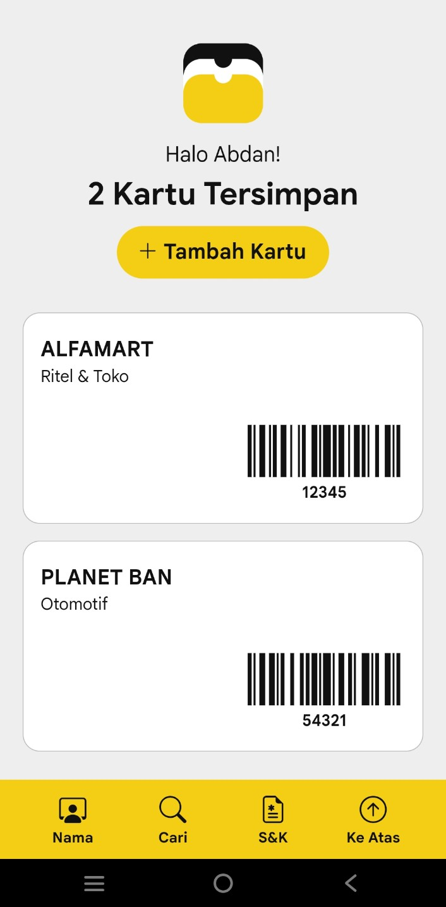

# Dompet Kartu Member
Aplikasi (berbasis web) yang dapat digunakan untuk menyimpan beragam Kartu Member di satu tempat.
- Gratis digunakan.
- Tidak perlu membuat akun.
- Data disimpan aman.
- Bebas tambah kartu berapa pun, tidak ada batasan.
- Kode batang dapat dipindai (scan) dengan berbagai alat.
- Bisa diakses offline (tanpa internet) dengan fitur terbatas.

# Fitur Aplikasi
- **Nama Pemilik** : Ubah nama dompet sesuai nama Anda.
- **Tambah Kartu** : Cukup isi nama kartu, pilih kategori kartu, dan isi nomor kartu.
- **Edit Kartu** : Tinggal tap/klik kartu yang ingin Anda ubah.
- **Hapus Kartu** : Menghapus kartu dengan mudah.
- **Pencarian** : Cari kartu dengan mudah, cukup ketik beberapa huruf.

# Contoh Penggunaan

